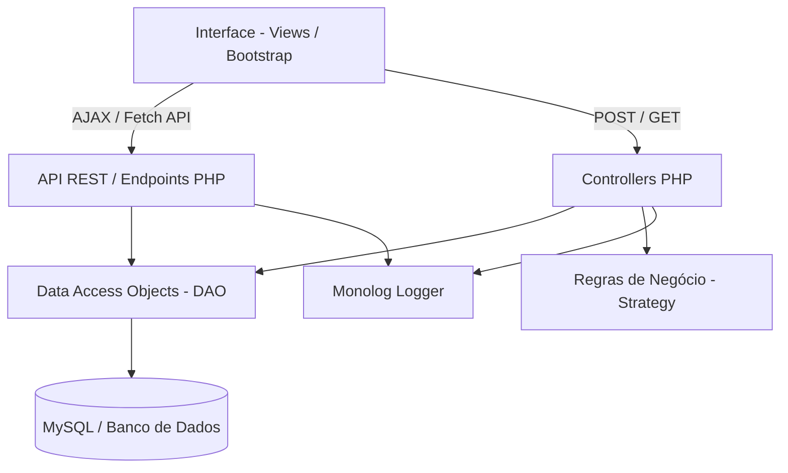

# SISPROMO - Sistema de Administração de Promoções


O **SISPROMO** (Sistema de Administração de Promoções) é uma plataforma web desenvolvida para automatizar e gerenciar o fluxo de promoções militares do Corpo de Bombeiros Militar de Mato Grosso (CBMMT). O sistema orquestra desde a elaboração do Quadro de Acesso (QA) até a geração automática das atas de promoção das Comissões de Promoção de Oficiais (CPO) e Praças (CPP), substituindo processos manuais por um motor matemático de "Efeito Cascata" aderente à legislação vigente.

---

## 🎯 Principais Funcionalidades

- **Processo Promocional Unificado:** Ciclo semestral que engloba Oficiais e Praças, mantendo a segregação na interface de reuniões (Sessões de Trabalho).
- **Geração de Atas (WYSIWYG):** Consolidação dos julgamentos de conduta moral, impedimentos objetivos, Quadro de Acesso e Propostas de Promoção em um documento editável via TinyMCE.
- **Motor Matemático (Efeito Cascata):** Cálculo automático de vagas (Reais, Derivadas e Ajustes Manuais) seguindo as regras de contêineres e top-down.
- **Dashboard e Auditoria:** Logging completo de todas as ações usando Monolog e relatórios de conformidade.
- **Isolamento de Camadas (Arquitetura):** Código modular baseado em Padrão DAO, Strategy (para regras impeditivas) e API RESTful interna.

---

## 📐 Arquitetura

O sistema está organizado em uma arquitetura de N-Camadas para facilitar a manutenção e escalar novas regras de negócio sem quebrar o motor central:



---

## 🛠️ Tecnologias Utilizadas

| Tecnologia | Finalidade |
|---|---|
| **PHP 8+** | Backend e lógica central da aplicação. |
| **MySQL (PDO)** | Banco de dados relacional e comunicação segura (Prepared Statements). |
| **Bootstrap 3.3** | Framework CSS/JS para o frontend (views). |
| **jQuery & AJAX** | Requisições assíncronas para comunicação com a API interna. |
| **TinyMCE** | Editor de texto rico para formatação das Atas. |
| **Composer (PSR-4)** | Gerenciamento de dependências e autoloading. |
| **Monolog** | Geração e manutenção de logs de auditoria estruturados. |
| **vlucas/phpdotenv** | Gerenciamento seguro de variáveis de ambiente. |

---

## 🚀 Instalação e Execução (Ambiente Local)

Siga os passos abaixo para rodar o projeto localmente:

1. **Clone o repositório:**
   ```bash
   git clone https://github.com/rafaelreisGH/SISPROMO.git
   cd SISPROMO
   ```

2. **Instale as dependências via Composer:**
   ```bash
   composer install
   ```

3. **Configure as Variáveis de Ambiente:**
   Copie o modelo de ambiente e preencha as credenciais. O arquivo `.env` está configurado no `.gitignore` para proteção:
   ```bash
   cp .env.example .env
   # Edite o .env com os dados do seu banco de dados e a sua chave da API TinyMCE
   ```

4. **Inicie o Servidor Local (ou configure o Apache/Docker):**
   ```bash
   php -S localhost:8000
   # Ou utilize o Docker se configurado no ambiente da sua equipe
   ```

5. **Acesse a Aplicação:** Abra `http://localhost:8000` no seu navegador.

---

## 📁 Estrutura de Diretórios

- `/api` - Endpoints RESTful que consomem DAOs e retornam JSON.
- `/Controllers` - Scripts controladores principais e ações de backend.
- `/Views` - Telas do sistema utilizando HTML5 e Bootstrap.
- `/src/DAO` - Classes Data Access Object para manipulação direta do MySQL via PDO.
- `/src/Config` - Configurações globais e carregamento do Dotenv.
- `/src/Regras` - Implementação das regras de negócio (Pattern Strategy).
- `/Logger` - Fabrica de Logs (LoggerFactory) configurada com Monolog.

---

## 🔒 Segurança e Boas Práticas

- **Credenciais Isoladas:** Nunca trafegue senhas no código. Use sempre variáveis no `.env`.
- **Prevenção contra SQL Injection:** Uso rigoroso de `PDO` e *Prepared Statements* em todas as queries.
- **Auditoria:** Toda ação de edição, inclusão e exclusão é registrada no log de auditoria, contendo IP, ID do Usuário, data/hora e a modificação realizada.

---
*Este é um projeto originário do CBMMT e publicado com fins de demonstração de proficiência e portfólio técnico, não contendo dados de produção.*